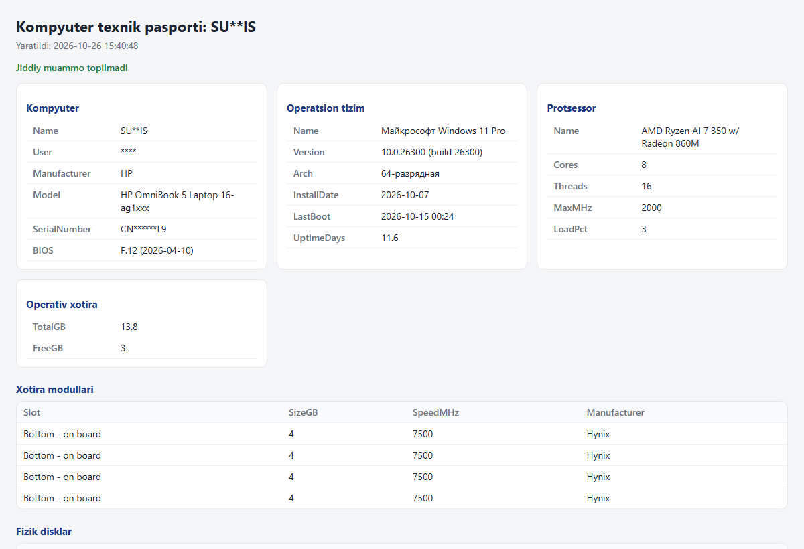

# it-support-toolkit — texnik xodim uchun PowerShell skriptlar to'plami

Kompyuterlarga xizmat ko'rsatishdagi takrorlanuvchi ishlarni avtomatlashtiradi:
inventarizatsiya, tezkor diagnostika, yangi kompyuterni sozlash va tarmoqdagi qurilmalarni topish.
Windows PowerShell 5.1 (Windows 10/11 ga o'rnatilgan holda keladi), qo'shimcha dastur talab qilinmaydi.

| Skript | Vazifasi | Qachon ishlatiladi |
|---|---|---|
| `Get-SystemReport.ps1` | Kompyuterning texnik pasporti: CPU, RAM modullari, disklar va ularning holati (Health Status), GPU, tarmoq, BIOS, batareya, xatoli qurilmalar, o'rnatilgan dasturlar → **HTML + JSON** | Inventarizatsiya, ta'mirdan oldin/keyin, kompyuter almashtirishda |
| `Test-Workstation.ps1` | 14 ta tekshiruv: disk joyi va holati, RAM, qayta yuklash, drayverlar, tizim jurnali, tarmoq → router → internet → DNS, antivirus, firewall, printer navbati. Har bir muammoga **tavsiya** beradi | "Kompyuter sekin / internet yo'q / printer chiqarmayapti" murojaatlarida |
| `Install-Workstation.ps1` | `apps.json` dagi dasturlarni winget orqali o'rnatadi. Standart holatda faqat **reja** ko'rsatadi | Yangi kompyuterni sozlash, multimedia yoki 3D laboratoriya kompyuterlari |
| `Find-NetworkDevices.ps1` | Tarmoqni parallel ping bilan skanerlaydi: IP, nomi, MAC | Robo-gid, proyektor yoki printerning IP manzilini topish |

## Ishlatish

PowerShell'ni oching (oddiy foydalanuvchi huquqi yetarli) va loyiha papkasiga o'ting:

```powershell
.\Get-SystemReport.ps1                 # reports\ papkasiga HTML va JSON
.\Get-SystemReport.ps1 -Anonymize      # seriya raqami, MAC, IP, foydalanuvchi nomi yashiriladi

.\Test-Workstation.ps1                 # rangli natija + tavsiyalar
.\Test-Workstation.ps1 -Json           # monitoring tizimlari uchun JSON

.\Install-Workstation.ps1 -Category multimedia          # reja: nima bor, nima o'rnatiladi
.\Install-Workstation.ps1 -Category multimedia -Apply   # o'rnatish

.\Find-NetworkDevices.ps1                               # joriy tarmoq
.\Find-NetworkDevices.ps1 -Subnet 192.168.10 | Export-Csv devices.csv -NoTypeInformation
```

Agar "running scripts is disabled" xatosi chiqsa (bir marta, faqat joriy foydalanuvchi uchun):
```powershell
Set-ExecutionPolicy -Scope CurrentUser RemoteSigned
```

## Namuna natijalar

**Diagnostika** (`Test-Workstation.ps1`):
```
[OK  ] Disk       Bo'sh joy C:                       304.7 GB (64%)
[OK  ] Disk       Holati: KBG60ZNV512G KIOXIA       SSD, Healthy
[OK  ] Tizim      Operativ xotira                    79% band
[WARN] Tizim      Jurnal xatolari (24 soat)          10 ta. Ko'p uchraydigan: Microsoft-Windows-HAL x6, ...
       -> Event Viewer > Windows Logs > System: manbasini tekshiring
[OK  ] Tarmoq     Router (gateway)                   192.168.x.x javob beradi
[OK  ] Tarmoq     Internet                           8.8.8.8 javob beradi
[OK  ] Xavfsizlik Antivirus (Defender)               Yoqilgan, bazalar 0 kunlik

Jami: OK: 13, WARN: 1
```
Chiqish kodi: `0` hammasi joyida, `1` ogohlantirish, `2` jiddiy muammo. Shu sababli skriptni
Task Scheduler yoki monitoring tizimi (masalan, [equipment-monitor](../equipment-monitor)) orqali ham ishlatish mumkin.

**Texnik pasport** (`Get-SystemReport.ps1 -Anonymize`):



**Dastur o'rnatish rejasi** (`Install-Workstation.ps1 -Category multimedia`):
```
  [bor]       VLC media player             VideoLAN.VLC
  [o'rnatish] OBS Studio                   OBSProject.OBSStudio
  [o'rnatish] K-Lite Codec Pack            CodecGuide.K-LiteCodecPack.Standard
```

## Diagnostika mantig'i: tarmoq muammosini bosqichma-bosqich aniqlash

```
Adapter ulanganmi? ──► Router (gateway) javob beradimi? ──► Internet (8.8.8.8)? ──► DNS (google.com)?
      │ yo'q                 │ yo'q                              │ yo'q                 │ yo'q
 kabel / Wi-Fi /       router o'chgan, kabel,             provayder muammosi     DNS sozlamasi
 drayver               IP olinmagan (DHCP)                                       (ipconfig /flushdns)
```

## Xavfsizlik va ehtiyotkorlik
- Hech bir skript sozlamalarni o'zgartirmaydi. Faqat `Install-Workstation.ps1 -Apply` dastur o'rnatadi.
- Hisobotlar (`reports/`) `.gitignore` da: ularda seriya raqamlari va ichki IP manzillar bor.
- `Find-NetworkDevices.ps1` faqat o'zingizga tegishli yoki ruxsat berilgan tarmoqda ishlatiladi.
